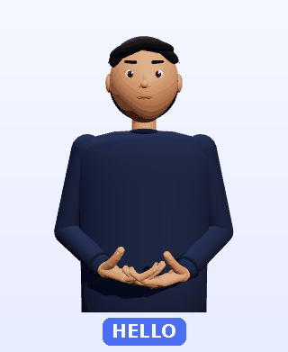

# 🤟 SignBuddy

**Live ASL signing for online meetings.** A Chrome extension that puts a small 3D character in the
corner of Google Meet, Zoom, Microsoft Teams or YouTube. It listens to the meeting audio, turns
speech into ASL gloss, and signs it in real time, with live captions underneath.

**▶ Live demo:** https://dwarakesh-007.github.io/signbuddy/



## Features

- Captures the meeting **tab audio** (not just the mic) with `chrome.tabCapture`
- Speech to text with Chrome's built-in Web Speech API (no API keys), built so Whisper can be plugged in later
- English → **ASL gloss** with simple rules (optional local Ollama step for better grammar)
- **3D character** (three.js): 5 fingers × 3 joints, arm IK, eyebrows for yes/no and WH-questions, head shake for negation
- Signs 19 common words and **fingerspells** everything else
- Drag, resize (S/M/L), hide with **Alt+Shift+S**, slow/normal/fast speed, captions on/off, "catching up…" notice
- Falls back to a simple 2D character on computers without 3D support

## Install (developer mode)

1. Download [`signbuddy-extension.zip`](signbuddy-extension.zip) and unzip it.
2. Open `chrome://extensions` and turn on **Developer mode**.
3. Click **Load unpacked** and pick the `signbuddy` folder.
4. Open a meeting or YouTube video, click the 🤟 icon and press **Start**.

## Repository layout

```
index.html, site.css, demo.js   website + live demo (GitHub Pages)
privacy.html                    privacy policy
extension/                      the Chrome extension (manifest.json is in here)
signbuddy-extension.zip         ready-to-install copy of extension/
assets/                         images for the website
```

Full technical notes, testing steps and limitations: [`extension/README.md`](extension/README.md).

## Related

[ASL Translator](https://dwarakesh-007.github.io/asl-translator/): the other direction, sign language to voice, using MediaPipe hand and face tracking.

## Credits

Built by [Cheela Dwarakesh](https://github.com/dwarakesh-007). Uses [three.js](https://threejs.org) (MIT licence).
